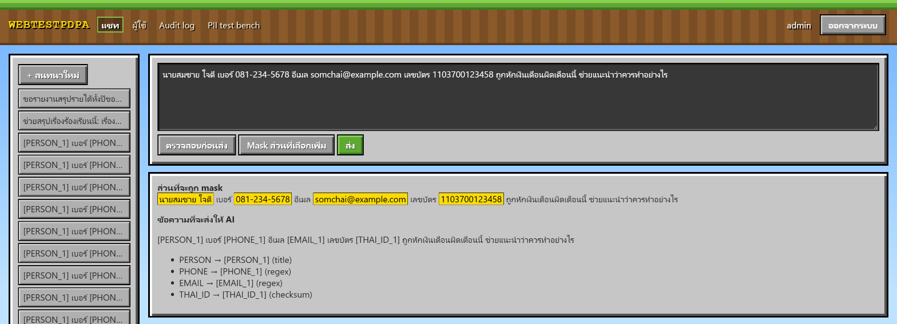
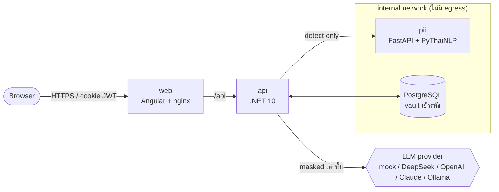
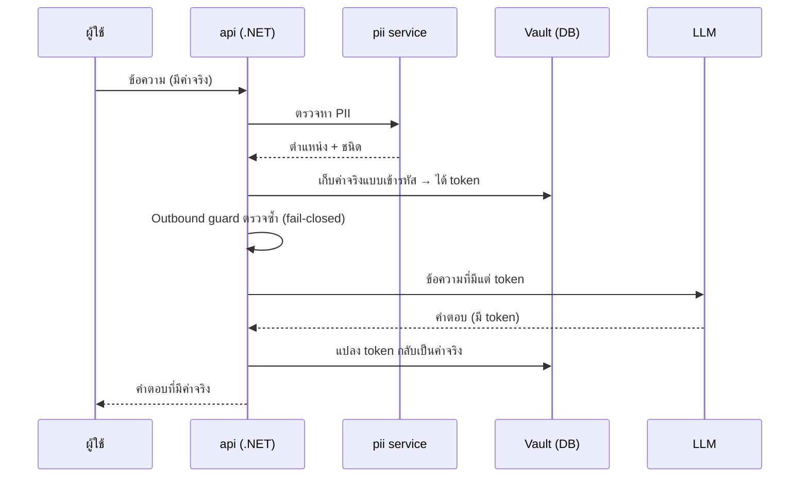
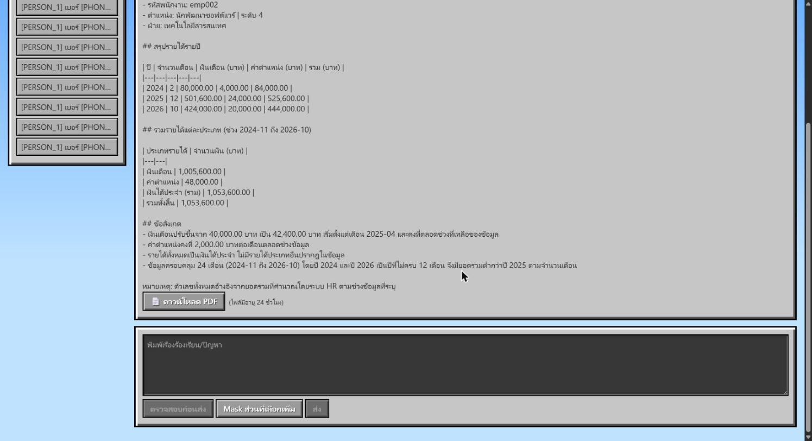
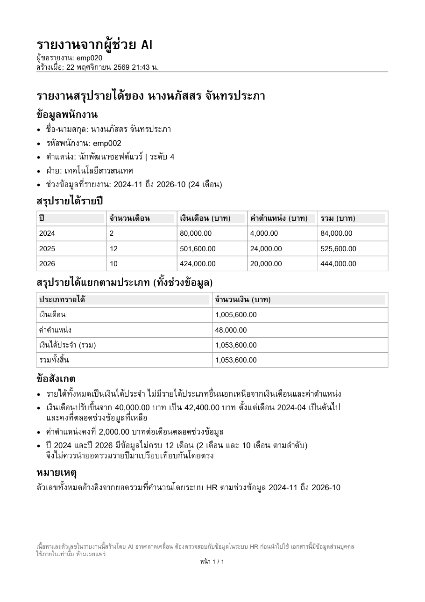
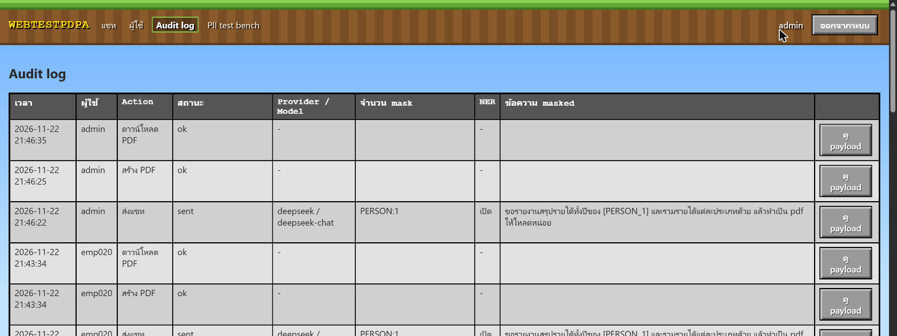
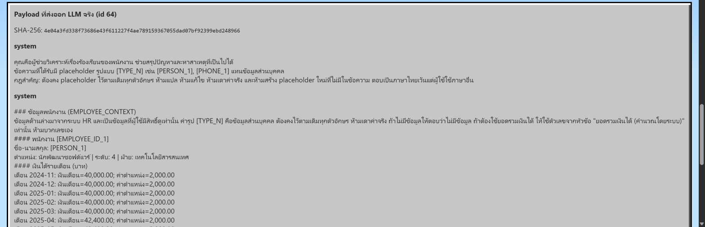

# WebTestPDPA — PII-safe LLM Chatbot (PDPA)

> Chatbot ให้พนักงานถามเรื่องร้องเรียนและข้อมูล HR ของตัวเองกับ LLM ได้ โดย **ข้อมูลส่วนบุคคลไม่ถูกส่งออกไปยัง LLM แม้แต่ตัวเดียว**
> แต่ผู้ใช้ยังเห็นคำตอบที่มีค่าจริงครบถ้วน

`Angular 20` · `.NET 10 Minimal API` · `EF Core` · `PostgreSQL 17` · `Python FastAPI` · `PyThaiNLP` · `Docker Compose` · `Microsoft.Extensions.AI`

> ข้อมูลพนักงานทั้งหมดในโปรเจกต์นี้เป็น **ข้อมูลสมมติ** (ชื่อ เลขบัตร เบอร์ เงินเดือน ฯลฯ) — สร้างขึ้นเพื่อทดสอบเท่านั้น

---

## ปัญหาที่แก้

องค์กรอยากใช้ LLM (ChatGPT, Claude, DeepSeek ฯลฯ) ช่วยงาน HR แต่ข้อความของพนักงานมีข้อมูลส่วนบุคคลปนอยู่เสมอ
เช่น ชื่อ เลขบัตรประชาชน เบอร์โทร เลขบัญชี และข้อมูลอ่อนไหวตาม **PDPA มาตรา 26** (ศาสนา สุขภาพ เชื้อชาติ)
การส่งข้อมูลเหล่านี้ไปยังผู้ให้บริการ LLM ภายนอกคือการโอนข้อมูลส่วนบุคคลออกนอกองค์กร

**แนวทาง:** วางระบบเป็น gateway คั่นกลาง — แทนค่าจริงด้วย token ก่อนส่ง แล้วแปลงกลับหลัง LLM ตอบ

```
ผู้ใช้พิมพ์   : คุณสมชาย ใจดี เบอร์ 081-234-5678 โดนหักเงินเดือนผิด
ส่งไป LLM    : [PERSON_1] เบอร์ [PHONE_1] โดนหักเงินเดือนผิด
LLM ตอบ      : แนะนำให้ [PERSON_1] ติดต่อ HR ... และแจ้งเบอร์ [PHONE_1] ไว้
ผู้ใช้เห็น    : แนะนำให้คุณสมชาย ใจดี ติดต่อ HR ... และแจ้งเบอร์ 081-234-5678 ไว้
```

**Preview ก่อนส่ง** — ผู้ใช้เห็นว่าอะไรจะถูก mask และข้อความที่ AI จะได้รับจริง (เลือก mask เพิ่มเองได้)



## Architecture





## จุดเด่นทางเทคนิค

### 1. Tokenization + Vault ที่เข้ารหัส
- ค่าจริงเก็บใน PostgreSQL ด้วย **AES-GCM** (nonce สุ่มทุกครั้ง, AAD = `conversationId|token`) — key แยกด้วย **HKDF** จาก master key เดียว
- token คงที่ภายใน conversation ผ่าน **HMAC** ของค่าที่ normalize แล้ว → `081-234-5678` กับ `0812345678` ได้ `[PHONE_1]` ตัวเดียวกัน ทำให้ LLM อ้างถึงคนเดิมได้ถูก
- ประวัติแชทที่ส่งเป็น context ให้ LLM เป็นฉบับ masked เท่านั้น — ตาราง `messages` ไม่มีค่าจริงเลย

### 2. ออกแบบแบบ Fail-closed
- PII service ล่ม / timeout / ส่งผลแปลกมา → **ไม่ส่ง LLM** (503) แทนที่จะส่งข้อความดิบออกไป
- **Outbound guard** ชั้นสุดท้ายใน .NET สแกนทุกอย่างที่จะออก (ข้อความ + ประวัติ + context) หาเลขบัตร/เบอร์/อีเมลที่หลุด → block (422)
- pii service และ DB อยู่บน Docker network `internal: true` — ไม่มีทางออกอินเทอร์เน็ต ไม่ publish port

### 3. ตรวจชื่อคนไทย
- Rule-based (คำนำหน้า นาย/นาง/ดร./คุณ, รายชื่อพนักงาน) + **NER ของ PyThaiNLP** + ตรวจ checksum เลขบัตรประชาชน
- จัดการกรณียากของภาษาไทยที่ไม่มีเว้นวรรค เช่น `นายสมชาย ใจดีเลขบัตร...` → ตัดนามสกุลที่ stop word ด้วย word tokenizer (`newmm`) ไม่ให้ mask เกิน
- หน้า **PII test bench** วัด precision / recall ต่อชนิดข้อมูลจาก dataset ทดสอบ

### 4. Chatbot ตอบจากข้อมูล HR โดยไม่เปิดช่อง prompt injection
- api ดึงข้อมูลที่เกี่ยวข้องมาแนบเป็น context **หลังตรวจสิทธิ์ฝั่ง server** — พนักงานเห็นได้แค่ข้อมูลตัวเอง, HR ระบุพนักงานเป้าหมายได้
- พนักงานทั่วไปพิมพ์ว่า "แสดงเงินเดือนของ emp002" ก็ไม่ได้ผล เพราะข้อมูลคนอื่น**ไม่เคยอยู่ใน payload** ตั้งแต่ต้น
- context สร้างจาก field ใน DB โดยตรง (รู้ชนิดข้อมูลจาก column) แล้ว tokenize — ไม่พึ่งความแม่นของ detector
- ข้อมูลอ่อนไหวมาตรา 26 (ศาสนา โรคประจำตัว กรุ๊ปเลือด เชื้อชาติ) ถูก mask เป็นชนิดเฉพาะ

### 5. รายงาน PDF + บทเรียน "อย่าให้ LLM บวกเลข"
- ผู้ใช้ขอ "...ทำเป็น pdf" → LLM เขียนเนื้อหา (เห็นแต่ token) → server แปลงกลับเป็นค่าจริงแล้ว render PDF ภาษาไทยด้วย **QuestPDF**
- ไฟล์เก็บแบบเข้ารหัส อายุ 24 ชั่วโมง ดาวน์โหลดได้เฉพาะเจ้าของ (คนอื่นได้ 404) และ `Cache-Control: no-store`
- **ผลทดสอบจริงกับ DeepSeek:** LLM คัดลอกตารางรายได้ 24 เดือนถูกทุกแถว แต่**บวกยอดรวมผิด 4,000 บาท** อย่างมั่นใจ
  → แก้โดยให้ server คำนวณยอดรวมแนบไปใน context และสั่งห้าม LLM คำนวณเอง → ตัวเลขตรงกับ DB ทุกตัว

| รายการ | LLM บวกเอง | หลังแนบยอดจาก server | ค่าใน DB |
|---|---|---|---|
| เงินเดือนรวม 24 เดือน | 1,001,600 ❌ | 1,005,600 ✅ | 1,005,600 |
| รายได้รวมทั้งสิ้น | 1,049,600 ❌ | 1,053,600 ✅ | 1,053,600 |

- ⚠️ แม้ยอดรวมจะถูกแล้ว ส่วนบรรยายที่ LLM เขียนเองยังพลาดได้ — ในรายงานด้านล่าง LLM เขียนว่าเงินเดือนปรับ "ตั้งแต่ 2024-04" ทั้งที่ข้อมูลจริงคือ 2025-04
  → ตัวเลข/วันที่ที่เป็นทางการควรมาจาก server หรือ template ทั้งหมด ให้ LLM ทำเฉพาะส่วนสรุป และต้องมี disclaimer (ซึ่ง PDF ใส่ไว้ทุกหน้า)

<table>
<tr>
<td width="50%"><br><sub>คำตอบในแชท + ปุ่มดาวน์โหลด PDF (ไฟล์มีอายุ 24 ชม.)</sub></td>
<td width="50%"><br><sub>PDF ที่ server render (ชื่อจริงกลับมาหลัง unmask, disclaimer ท้ายหน้า)</sub></td>
</tr>
</table>

### 6. Audit ที่ตรวจสอบย้อนหลังได้
- บันทึก payload ทั้งก้อนที่ส่งออก LLM จริง (ฉบับ masked) พร้อม **SHA-256** → พิสูจน์ได้ว่าอะไรออกจากระบบไปบ้าง
- บันทึกว่าใครเข้าถึงข้อมูลพนักงานคนไหน หมวดไหน (เก็บแค่ id ไม่เก็บค่า), การสร้าง / ดาวน์โหลด PDF
- ทุกทางออกหลังส่ง payload ไปแล้ว (error, timeout, ผู้ใช้ปิดแท็บ) ยังมีแถว audit เสมอ
- Retention job ลบข้อความ / vault / audit / รายงานที่หมดอายุอัตโนมัติ



**Payload ที่ส่งออก LLM จริง** — มีแต่ token (`[PERSON_1]`, `[EMPLOYEE_ID_1]`) ส่วนตัวเลขเงินเดือนส่งเป็น plain เพื่อให้ LLM วิเคราะห์ได้ และมียอดรวมที่ server คำนวณแนบไป



## ความปลอดภัยอื่นๆ
- JWT ใน **httpOnly cookie** (`SameSite=Strict`), rate limit ต่อผู้ใช้, account lockout
- ไม่ log ค่า PII ทุกชั้น (ปิด `UseLogging` ของ M.E.AI, ห้าม `EnableSensitiveDataLogging`, FastAPI ไม่ echo input ใน error)
- secret ทั้งหมดอยู่ใน `.env` (สคริปต์สุ่มให้) ไม่อยู่ในโค้ด
- สลับ LLM provider ได้ด้วย env ตัวเดียว — มี `mock` ที่ไม่ออกเน็ตไว้ทดสอบ

## การทดสอบ

| ชั้น | เครื่องมือ | จำนวน |
|---|---|---|
| API | xUnit + **Testcontainers** (PostgreSQL จริง) | 276 tests |
| PII service | pytest + bench dataset | 166 tests |
| End-to-end | PowerShell script บน Docker Compose จริง (ตรวจว่าไม่มี PII รั่วไป outbound / audit / logs) | 12 ขั้น |

## ลองรันเอง

ต้องมี Docker Desktop

```powershell
.\scripts\new-env.ps1        # สร้าง .env + สุ่ม secret (LLM_PROVIDER=mock ไม่ต้องมี API key)
docker compose up --build
```

เปิด `http://localhost:8080` แล้ว login ด้วย `ADMIN_USERNAME` / `ADMIN_PASSWORD` ใน `.env`
หรือ user พนักงาน `emp001`–`emp020` (รหัสผ่านจาก `EMPLOYEE_SEED_PASSWORD`, `emp020` เป็น HR)

ตัวอย่างคำถาม: `เงินเดือนของฉัน` · `ลาพักร้อนปี 2026 ไปกี่วัน` · (HR) `ขอรายงานสรุปรายได้ของ emp002 แยกตามประเภท ทำเป็น pdf`

รายละเอียดการตั้งค่า, provider, การทดสอบ และข้อจำกัดทั้งหมด → **[docs/DEVELOPMENT.md](docs/DEVELOPMENT.md)**

## ข้อจำกัด (ตรงไปตรงมา)
- การตรวจ PII **ไม่มีทางได้ 100%** โดยเฉพาะชื่อไทยที่ไม่มีคำนำหน้า — ระบบจึง bias ไปทาง over-mask และมีหน้า preview + ปุ่ม mask เพิ่มเองก่อนส่ง
- intent ของ chatbot ใช้ keyword ไม่ใช่ NLU
- เป็นโปรเจกต์ทดสอบแนวคิด ไม่ได้ผ่าน security review สำหรับ production

## เครื่องมือที่ใช้พัฒนา
พัฒนาร่วมกับ **Claude Code** ในรูปแบบ plan → implement → review (ให้ AI อีกตัวรีวิวจนผ่านก่อนรวมงาน) โดยกำหนด spec, ตัดสินใจเชิงออกแบบ และทดสอบผลเอง
